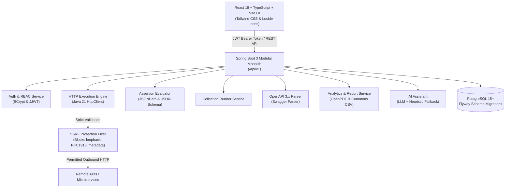

# APIWise — Intelligent API Testing and Automation Platform

[](https://spring.io/projects/spring-boot)
[](https://openjdk.org/)
[](https://react.dev/)
[](https://www.typescriptlang.org/)
[](https://tailwindcss.com/)
[](https://www.postgresql.org/)
[](LICENSE)

**APIWise** is an enterprise-grade, developer-centric API testing, automation, and continuous verification platform. Built with Java 21, Spring Boot 3, and React 18, it combines the interactive request ergonomics of Postman with automated assertion pipelines, collection batch runners, real-time SQL analytics, OpenAPI 3.x specification ingestion, SSRF-protected execution engines, and optional AI test generation with resilient heuristic fallbacks.

---

## 🌟 Key Features

### 1. Interactive API Request Builder
- Full support for `GET`, `POST`, `PUT`, `PATCH`, and `DELETE` methods.
- Dynamic key-value editors for Query Parameters and Headers.
- Configurable Authentication modes: `None`, `Bearer Token`, `Basic Auth`, and `API Key`.
- Body types: `JSON`, `Form URL-encoded`, `Plain Text`, and `None`.
- Telemetry viewer displaying HTTP status badges, roundtrip response time (ms), payload size (bytes), response headers, and formatted JSON/raw body viewers.
- Environment variable interpolation (e.g. `{{baseUrl}}/api/v1/users`).

### 2. Automated Test Assertion Engine (No Code Required)
Configure automated test assertions evaluated instantly upon request execution:
1. **HTTP Status Code**: Equals, Not Equals, Less Than, Greater Than.
2. **Response Time**: SLA performance thresholds (e.g., `< 500ms`).
3. **JSONPath Existence**: Verify specific fields exist in response payloads (`$.data.id`).
4. **JSONPath Value Matching**: Exact match, substring contains, or regular expressions.
5. **JSON Field Type Checking**: Validate schema types (`string`, `number`, `boolean`, `array`, `object`).
6. **Array Length Constraints**: Equals, Greater Than, or Less Than expected item counts.
7. **Response Header Rules**: Header existence, case-insensitive value matching.
8. **JSON Schema Validation**: Strict contract compliance according to JSON Schema specifications.

### 3. Collection Runner & Historical Telemetry
- Execute multi-request collections sequentially with configurable inter-request delays.
- Full execution audit trail persisted to PostgreSQL (`test_runs`, `test_run_items`, and `assertion_results`).
- Inspection view detailing every executed request, URL, response headers, response payload, and per-assertion status.

### 4. Real-time Dashboard & PDF/CSV Export
- Real SQL aggregations for pass rates, run counts, and average response times.
- 7-day chronological run volume charts powered by Recharts.
- One-click audit exports:
  - **PDF Export**: Formatted test report tables generated via OpenPDF.
  - **CSV Export**: Granular machine-readable test execution logs via Apache Commons CSV.

### 5. OpenAPI 3.x Ingestion
- Upload or paste OpenAPI 3.0/3.1 specs (JSON or YAML) or safe external URLs.
- Interactive endpoint preview extracting paths, methods, parameters, and response codes.
- Batch import into target projects and collections.

### 6. Robust Application Security & SSRF Defense
- **Strict SSRF Filter**: Prohibits requests targeting loopback addresses (`127.0.0.1`, `localhost`), link-local IPs, cloud metadata endpoints (`169.254.169.254`), and private subnets (`10.0.0.0/8`, `172.16.0.0/12`, `192.168.0.0/16`).
- **Encrypted Variables**: Sensitive environment secrets (API tokens, passwords) are encrypted at rest using AES-256-GCM.
- **BCrypt & JWT**: Industry-standard password hashing and short-lived HS512 JWT access tokens.
- **Workspace-Level RBAC**: Complete isolation between workspaces and team members (`OWNER`, `ADMIN`, `MEMBER`).

### 7. AI-Assisted Testing with Resilient Fallback
- Generates draft assertions based on response body structure and status code.
- Generates negative testing scenarios (boundary checks, missing auth, invalid payloads).
- Explains assertion failures and suggests actionable remediations.
- **Resilient Fallback**: Operates with full functionality via rule-based heuristic algorithms even if LLM API keys are unconfigured.

---

## 🏛️ System Architecture



---

## 🚀 Quick Start with Docker Compose

Ensure Docker and Docker Compose are installed, then run:

```bash
# 1. Clone repository and copy environment defaults
cp .env.example .env

# 2. Build and launch all services
docker-compose up --build -d
```

Access the interfaces:
- **Frontend Dashboard**: [http://localhost:3000](http://localhost:3000)
- **Spring Boot Backend**: [http://localhost:8080/api/v1](http://localhost:8080/api/v1)
- **Interactive Swagger UI**: [http://localhost:8080/swagger-ui.html](http://localhost:8080/swagger-ui.html)
- **Actuator Health Check**: [http://localhost:8080/actuator/health](http://localhost:8080/actuator/health)

---

## 🛠️ Local Development Setup

### Backend (Spring Boot 3)
```bash
cd backend
mvn test             # Run automated test suite (17 tests)
mvn spring-boot:run  # Starts backend server on port 8080
```

### Frontend (React + Vite)
```bash
cd frontend
npm install
npm run dev          # Starts Vite dev server on port 5173
npm run build        # Verifies production bundle build
```

---

## 📚 Complete Project Documentation

- 📖 [**Explanation of All Technical Decisions ("The Whys")**](file:///n:/Api-wise/docs/EXPLANATION_OF_WHYS.md) — Comprehensive explanation detailing the architectural and engineering rationale for every layer.
- 🏗️ [**Architecture Guide**](file:///n:/Api-wise/docs/ARCHITECTURE.md) — Structural diagrams, request lifecycle, and security model.
- 🗄️ [**Database Design & Schema**](file:///n:/Api-wise/docs/DATABASE.md) — Entity-relationship diagrams, table structures, and indexing rationale.
- 📡 [**REST API Reference Manual**](file:///n:/Api-wise/docs/API.md) — Complete endpoint catalog, request payloads, and response formats.
- ⚙️ [**Setup & Deployment Guide**](file:///n:/Api-wise/docs/SETUP.md) — Environment variables, local bare-metal setup, and troubleshooting.
- ✅ [**Acceptance Verification Report**](file:///n:/Api-wise/docs/ACCEPTANCE_REPORT.md) — Itemized acceptance checklist and test outputs.

---

## 📄 License
This project is open-source under the [MIT License](LICENSE).
