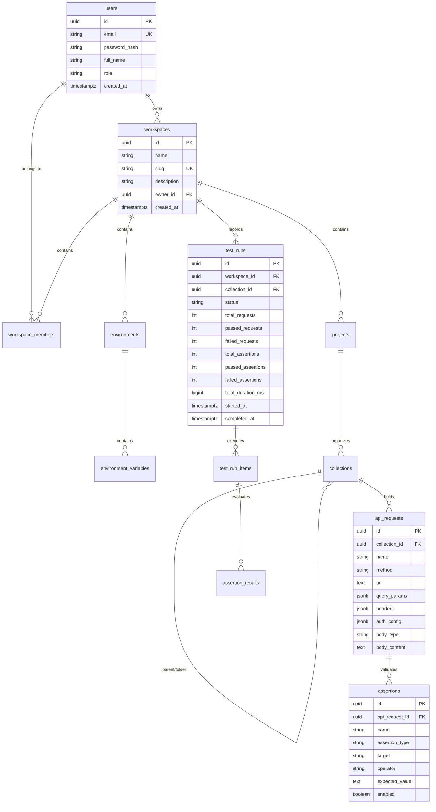

# APIWise — Database Specification & Schema

## Entity Relationship Overview

## Migration & Tables

1. **`users`**: Stores user authentication credentials and full names. Password hashes generated via BCrypt (strength 10).
2. **`workspaces`**: Multi-tenant workspace partitions.
3. **`workspace_members`**: Membership link with granular roles (`OWNER`, `ADMIN`, `MEMBER`, `VIEWER`).
4. **`projects`**: High-level grouping for collections.
5. **`environments`** & **`environment_variables`**: Environment scopes with encrypted secrets (`AES-256-GCM`).
6. **`collections`**: Hierarchical folders for API requests. Supports parent recursion.
7. **`api_requests`**: Saved HTTP request configurations with `jsonb` parameters, headers, and authentication.
8. **`assertions`**: Automated test rules covering 8 assertion types.
9. **`test_runs`**, **`test_run_items`**, **`assertion_results`**: Full persistent execution history and audit telemetry.
